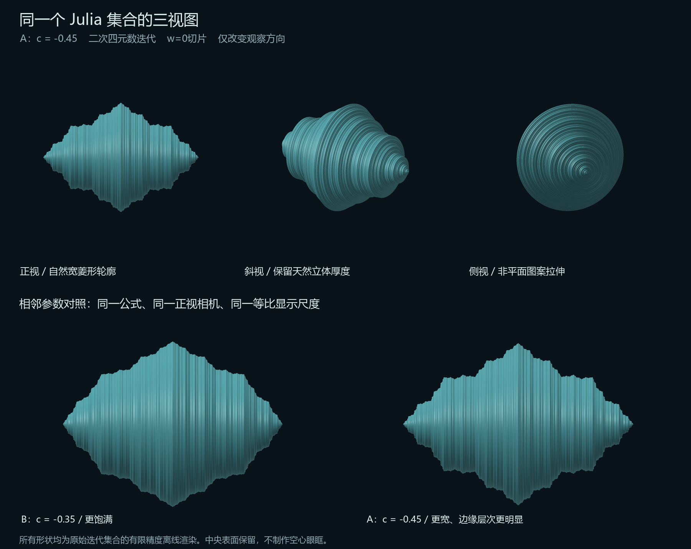

# Julia离线数学渲染与验证

日期：2026-10-27。阶段7参数已锁定为**二次四元数q(n+1)=q(n)²−0.5，q0=(x,y,z,0)**。下图来自原始迭代的离线渲染，不是游戏截图；白色只标出原形覆盖，实际游戏在覆盖内显示目标原生天空，不绘制白色材质或表面厚度。

## 当前原形：c=-0.5

正视：


斜视：



侧视：



三个离线机位均使用正交相机，只改变观察方向，集合不变。运行时已按用户确认改为以裂口中心方向为轴的弱透视，以使参考眼点64的轮廓匹配此正视图；128格内的近景恢复真实透视，中间平滑过渡。没有菱形裁剪、非等比缩放、CSG、中央挖孔或眼眶加工；真实风暴与原形投影的最终比例由眼点64、1.2R参考圆及入口64圆约束，详见[阶段7实施说明](allay-storm-stage7-eye-art-plan.md)。

## 数值验证

- 原始距离估计光线渲染：192次迭代、最多1200步、epsilon=0.00035、900×900覆盖图。独立CPU逃逸／捕获测试使用4097个径向采样；c=-0.5覆盖IoU为**0.997086**，99%列边误差≤2像素，最大5像素。
- 运行时资源另由2049×1025复平面网格提取全部4662条轮廓，再绕原实轴旋转；保留126列存在的径向断开区间，不拿最大半径填平间隙。最大网格间距约0.001334集合单位。
- 生产运行时边界与独立原始距离估计GPU渲染IoU为**0.995670**。修复正交／透视标准不一致后，参考眼点、3种FOV及转头共9组正视IoU为**0.99570～0.99714**，并另测侧面／上方和不同风暴半径；新增近距与偏轴首帧入口覆盖，6430项GPU检查通过。有限网格、角向细分和光线epsilon均会产生数值误差，不宣称无限分辨率精确几何。

参数和结果：[quadratic-c050-verification.json](design-assets/julia-offline/quadratic-c050-verification.json)。源码：`scripts/art/JuliaOfflineRender.java`、`julia-offline.frag`、`julia_verify.py`、`julia_runtime_boundary.py`；运行时必需的`quadratic-c050.bin`及`quadratic-c050-fit.json`位于`src/main/resources/data/createmanaindustry`，由内置资源加载器读取；只供离线记录的`quadratic-c050.json`位于`docs/design-assets/julia-offline`，不打入分发jar。

```powershell
.\gradlew.bat -I scripts/art/julia-offline.init.gradle renderJuliaOffline -PjuliaMode=51 --offline --no-configuration-cache
python scripts/art/julia_verify.py
python scripts/art/julia_runtime_boundary.py
.\gradlew.bat -I scripts/particles/validation.init.gradle validateJuliaProjectionGpu --offline --no-configuration-cache
```

离线视图不代替最终天空／云盘的真实客户端验收，后者由用户执行。

## 前期候选记录

此前c=-0.45与c=-0.35的数学形体和CPU验证保留作参数探索记录，**均不再是阶段7选择**。下图中的实体照明只用于当时观察母体结构，不进入游戏渲染。



前期参数和复核：[parameters-and-verification.json](design-assets/julia-offline/parameters-and-verification.json)。
