# 阶段7：共享中心、原形Julia天空裂口与原生云

日期：2026-10-27。状态：**代码已接入，自动验证与客户端验收分开记录。新Julia、半日天空及云盘的真实客户端验收由用户执行，尚未签收阶段7。** 既有八包实体合并、阴影、探针、原生体积雾，以及阶段3～6基线裂口／共享天空的验收继续保留。

本页是阶段7的当前方案和实现说明，覆盖此前候选参数、实体分形材质、复杂主体包络、10tick摘要和测试天空设计。后续装饰、招式美术、返回入口及新增后处理不在本轮。

## 1. 已锁定的表现

- 标准二次四元数Julia：`q(n+1)=q(n)^2-0.5`，`q0=(x,y,z,0)`。保留中央、外轮廓和原生分支，不挖孔、不裁成菱形、不非等比缩放。
- 集合只产生随视角变化的覆盖和命中距离；覆盖内显示目标原生天空。**不画实体材质、表面照明或厚度着色。** 侧面、上方和近处仍按同一三维集合投影。
- 参考眼点严格为`(中心X,64,中心Z)`；风暴参考体是中心高度处、半径`1.2R`的水平圆。`R=vortexRadius(共享插值生成数量)`，不扫描GPU成员或拟合复杂包络。
- Julia中心为共享插值XZ及`来源maxBuildHeight+64`，实轴长轴固定朝东西；仅平移、刚性放置及统一缩放。原形投影见[离线记录](allay-storm-julia-offline-renders.md)。

## 2. 同一条中心与数量时间线

`StormCenterSample / StormCenterTimeline`不依赖GPU，`StormCenterView`按客户端世界持有唯一时间线；主体、裂口和原生云读取相同前后采样、游戏时间与partial tick。世界坐标先以double插值，再转相机相对float。

按用户最新确认：**摘要跟随中心流产生新规范采样的事件更新，当前每20tick一次；无独立10tick定时器或发送tick。** 首次订阅、开放、STOP及目标可用性变化立即发送，复用已有规范采样，以sequence区分状态。新近景订阅重发已发布的中心包，不在同一tick重新计算生成数量。摘要携带前后两份规范采样，可独立维持远景；退出成员追踪不清空中心，不启动成员模拟或取得authority。

保留20tick延迟、`alpha∈[0,1]`、首包初始化、断流钳制和暂停不推进。相同身份／采样tick去重；晚到前包可补齐首个插值区间；旧epoch和乱序包不回退。入口资格及运输锚点仍使用服务端真实位置。

必需协议为**20**；中心XYZ改double，摘要新增中心Y、数量采样和冻结增长定义，天空上下文增加fraction、perTick及修订号。未升级Iris、Veil、Sodium或其他依赖。

## 3. Julia数值边界和覆盖拟合

对实常数c，四元数虚部方向不变，可把原始复平面的全部边界绕实轴旋转，得到同一三维切片。`scripts/art/julia_runtime_boundary.py`离线生成192迭代、2049×1025网格的**全部4662条轮廓段**，保留细小径向断开区间，不取径向最大值填成实心壳。数值网格最大间距约0.001334集合单位；这是有限分辨率近似，不宣称精确表达无限细节。运行时必需的边界`quadratic-c050.bin`与拟合参数`quadratic-c050-fit.json`存于`src/main/resources/data/createmanaindustry`并通过内置资源加载；离线说明`quadratic-c050.json`存于`docs/design-assets/julia-offline`，不打入分发jar。

用户本轮确认八包及无光影均可见裂口，但正下方两端偏向斜视轮廓。根因为离线`front-mask`采用正交相机，旧运行时采用有限距离透视；独立原始迭代的透视复现与旧运行时IoU为0.997408，属于投影标准不一致，而非包适配或Julia轴向错误。用户已确认改为正交／弱透视以匹配正视参考。

`JuliaProjection`现以相机至裂口中心的方向确定弱透视轴，保留局部Julia坐标、世界东西实轴和全部原始边界。该轴不随单纯转头旋转；改变观察位置仍得到原形的不同投影。距离≥256格采用完整弱透视；≤128格恢复真实透视，中间平滑过渡，避免靠近／穿入入口时投影奇异。投影携带统一放大保护，使包含在集合中的半径64球的视线锥不缩小，入口圆因而持续被覆盖；同一投影结果生成线性命中距离，天空及云裁剪仍共用该纹理。

`JuliaShape`已移除旧透视比例查找表，改由离线原形正视投影的内切半径直接校准眼点64所见的`1.2R`圆，再与入口64圆要求取较大统一比例，留1%参考覆盖余量。参数、原始轮廓及三轴一致的集合缩放保持原规则；仅投影镜头发生变化。首帧满足入口覆盖，2秒平滑展开；异常配置导致参考眼点不处于完整弱透视范围时保留入口覆盖，并在status报告构图状态。

`JuliaProjection`每个主视角生成一次覆盖／线性命中距离纹理，无光影与八包共用。天空、天体和云采样此纹理，云循环不重新迭代分形；未命中明确为-1。遮罩资源随分辨率重建、资源重载替换，不固定占用纹理单元或colortex编号。

## 4. 原生目标天空与完整时间

移除低亮蓝青测试天空及方向星标。悦灵维度使用原版／当前包原生天空、天体、星星和昼夜渐变；`AllayLevelData`只读映射`主世界完整dayTime-12000`，保留日历和月相的有符号时间，gameTime、天气及机器／传送计时规则不变。

客户端目标上下文同步昼夜开关、速率和分数，负时间不再走原版“取绝对值并关昼夜”逻辑。临时`SkyRenderScope`只对所属渲染线程的客户端查询生效，不修改世界，不影响集成服务端或来源阴影。

无光影时，`VanillaSkyView`只重放原版天空到独立颜色／深度目标，无第二客户端世界或地形。Iris下，`NativeSkyView`克隆本包有效天空gbuffer及必要deferred／composite程序，保留解析指令、有效选项、geometry阶段、自定义纹理和采样器分配；目标使用独立uniform图、场景缓冲、天空缓存和云历史。原生HDR／gamma／iteration输出倍率在原插入点还原；来源曝光及后续镜头效果只应用一次。

目标变体不递归采样裂口，不把主世界局部遮罩写入原有sky-map、SH或反射缓存；共享image写入被移除，不支持的共享存储写入在发布前拒绝。持久缓冲沿用Iris的alt→main历史拷贝规则。重载／切包销毁所属资源，尺寸变化重建深度与附件；逐附件混合及颜色写入掩码、scissor、深度、viewport和pipeline phase均恢复。

## 5. 原生云盘及八包路径

来源云盘从风暴出现逐渐形成，出生／STOP各2秒淡变，生成数16384时完整。影响半径`clamp(8R,96,384)`；中心疏云区为半径四分之一，中心密度最低0.3倍，外环最高1.6倍，边缘恢复原值。只扭转原生噪声采样的XZ，不挪云高或重建云几何；旋转为未取模主体积分相位的0.1倍，叠加原生风。目标维度和裂口内使用自然目标云，不加入来源云盘。

无有效光影云不补云；主世界原版云遵循玩家设置，悦灵维度和裂口内无替代云。来源前景云正常遮挡窗口，裂口后的来源云裁掉，目标云仅在投影内显示。地形和真实风暴保持正常前景遮挡。

| 验证样本（名称版本仅作样本标签） | 目标天空／云链 | 来源云盘采样接点 | 新客户端结果 |
| --- | --- | --- | --- |
| Complementary Unbound r5.9.3 | deferred1与原生天空gbuffer | Unbound／Reimagined密度及噪声 | 待用户验收 |
| Photon v1.4 | 独立d0 sky-map、d1云、d2历史、d4天空 | 积云、高积云、浓积云、卷云及方块云密度 | 待用户验收 |
| Bliss v2.1.2 Chocapic13 edit | deferred大气、云通道、composite1／3合成 | 原生卷层／积云密度 | 待用户验收 |
| BSL v10.1.1 | deferred1与原生gbuffer | CloudSample，保留原生单位比例 | 待用户验收 |
| iterationT 3.2.0 | deferred3原始天空与云、保留geometry | NUBIS及PlanarClouds密度／采样位置 | 待用户验收 |
| Sildur’s Vibrant v2.02 Extreme | 传统deferred天空，无compute要求 | 2D与3D云噪声／密度 | 待用户验收 |
| Solas V3.8 | deferred1天空、体积及平面云 | 原生采样比例换算、平面云噪声 | 待用户验收 |
| Sundial Lite v1.2.0 | Composite4原生HDR场景及云 | realistic、plane及blocky原生DDA噪声 | 待用户验收 |

匹配依据是完整路径、include结构、有效program和选项，不按包文件名或版本白名单启用。补丁仍在副本上原子预检，不改用户zip。八包的代码接入和编译通过不能替代完整显示验收。

## 6. 自动验证记录

- 单元测试覆盖共享采样到达顺序、重复／乱序、旧epoch、首包、断流、高坐标和长存档tick；协议round-trip保留double、有符号时间与速率；读取实际Iris／Minecraft字节码检查Mixin ABI。
- 独立服务端回归9项通过，含只读半日时间、跨午夜／负时间、gameTime不变及原有整组传送测试。日志：`build/stage7-server-regression.log`。
- 八包默认、关云及替代云共24组，实际Iris预处理、转换、GL驱动编译链接来源及独立目标程序；同时保留重命名／目录／同名替换、缺失／重复锚点与格式变动的结构验证。关云时部分包仍保留云影辅助代码，不能把uniform存在直接当作可见云支持。
- 原始Julia边界与独立原迭代轮廓IoU约0.99567。投影修复后，参考眼点FOV 60／90／110、转头±约12度的9组正视对照IoU为0.99570～0.99714；侧面／上方和R=16／32／64另9组保持原集合投影一致。新增近距、偏轴及上方的首帧入口圆检查；Julia GPU共6430项通过，天空／云裁剪／状态恢复12323项通过。日志：`build/julia-weak-projection-regression.log`。
- 完整build及923项JUnit全部通过，无失败／错误／跳过。最终驱动结果：八包24组883项、Julia 6430项、天空合成／状态／云盘12323项；world-effects 287785项、scene-frame 72764项、程序生命周期575项、MODEL阴影4133608项、包裹26771项、Hex 5291项。构建日志：`build/julia-projection-fix-build.log`；投影及遮挡日志：`build/julia-weak-projection-regression.log`；其余既有驱动回归日志：`build/stage7-regression.log`。生命周期的预期失败注入日志不代表测试失败。
- 原形离线图及CPU独立验证见`build/stage7-julia-cpu.log`；服务端9项独立测试记录如上。自动结果不签真实客户端观感和帧率。

## 7. 用户实机检查清单

使用新构建，记录每包`/cmi particle shaderpack status`与`debug.log`。分别检查无Iris、Iris无包及八款样本；新结果全部待用户执行。

先使用投影修复后的新构建重启客户端，复验眼点y=64正下方的左右两端；新结果仍由用户记录。

1. **中心一致**：眼点64正下方、count为16384／32768／65536／131072，移动风暴、远离成员追踪区再靠近；主体、裂口和云盘XZ一致，无近远切换跳位。暂停、断流、STOP重建、重新登录后不串旧epoch。
2. **原形与覆盖**：不同FOV、偏轴、侧面、上方、近距离及穿越入口面；Julia中央完整，无挖孔、平面追镜头、人工菱形边或实体厚度着色；入口圆始终覆盖，地平线不串色。
3. **四时段**：主世界0／6000／12000／18000分别对应目标-12000／-6000／0／6000；再测负时间、睡觉跳时、时间命令、昼夜关闭和NeoForge速率变化。来源天体／阴影不随裂口跳时，目标维度与窗口的天体方向和天气一致。
4. **云开关**：每包默认、关云、适用替代云／质量配置；云高不变，来源宽阔旋涡随数量成长，中心疏云，出生／停止淡变；前景云保留、后景来源云排除、目标云局限于投影。不允许无云选项被模组补云。
5. **生命周期**：粒子关闭仍显示裂口，F3+T、切包、同名更新、尺寸变化、维度往返、断线后不双绘或残留资源；HUD和来源缓存不污染。记录资源异常、GL错误及status中的拒绝原因。
6. **旧功能回归**：实体合并、MODEL／Iris阴影、包裹／Hex、探针auto／baseline和八包原生体积雾；旧验收记录保留，发现回归单独报告。

阶段7只有取得上述新视觉结果后才标记验收完成；本轮不将代码验证写成实机通过。
