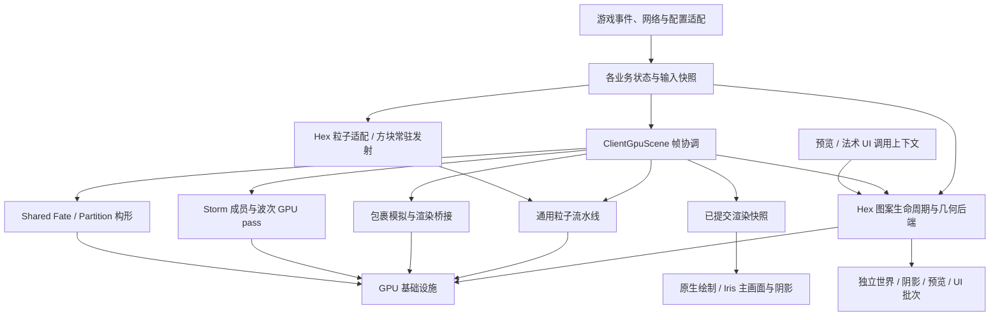

# GPU 运行时架构与性能优化方向

状态：🚧 实施中，尚未完成全量验收。分析日期：2026-10-16；实施进度更新：2026-10-17，分析基线：`6b27b6ff`。第 2～9 节保留原分析与候选决策；当前已落地内容以第 0 节为准，不能将未实施候选或历史基准当成新版本验收结果。

范围：GPU 运行时当前承载的全部功能：通用发射 API／命令／预设、方块常驻发射、Hex Conjure／Spray 粒子、独立 Hex 图案的世界／阴影／预览／法术 UI、普通 MODEL 悦灵与战斗交互、GPU 包裹、Allay Storm，以及 Great Trick 当前的 Shared Fate／Partition GPU 特效，并覆盖它们的材质、光照、碰撞、反馈和生命周期基础设施。这里的“承载”同时包括共享粒子池和独立 GPU 后端，不表示全部经过同一条模拟流水线。

Great Trick 的字形、书本及交互 UI 仍有独立 CPU 绘制路径；Hex 石板、卷轴、tooltip 等也不在当前图案接管范围。普通预设的存在不代表已全局接管 Minecraft 同名粒子，例如樱花预设不等于重定向全部原版落叶。

## 0. 实施进度与当前验收边界

第四批实际所有者、直接调用、五域包迁移、场景与预算接线及故障隔离已实现，详情、调用归属和自动验证入口见[第四批实施报告](gpu-runtime-stage4.md)。后文第 2～9 节中的旧引擎方法、行数和依赖是分析基线，不是当前代码结构。

真实客户端验收按用户要求交由用户执行，不再由代理操作客户端；自动代码／GLSL／GameTest／性能夹具继续推进。检查清单及隔离运行入口见[客户端验收](gpu-runtime-client-acceptance.md)，尚无用户执行结果的项目保持待验收。

执行基线已明确为 Minecraft 1.21.1／NeoForge 21.1.236／**Create 6.0.10**，不升级或扩大为双版本支持。实际解析 JAR 的 `Git-Hash` 与本地 Create 提交 `ac0c444d9828da3453ae8cc65338e8de063286fb` 一致；环境审计改为读取该提交，不读取参考工作树 HEAD。Hex 使用实际依赖 `0.12.0-devel-pre-53`。

| 项目 | 当前实现 | 验收／剩余工作 |
| --- | --- | --- |
| 公共 GPU 机制 | 按 GL 上下文缓存能力与容量限制、计算／绘制程序编译器、持久映射读回存储、按所有者失效的 uniform 缓存、独立源码解析／资源加载、按需增长和零等待退休、timestamp 对计时；公共增长／读回缓冲删除前使活动状态快照中的旧名称失效 | 单元与真实 GLSL 回归已运行；带有效数据增长与嵌套计算／绘制退休恢复专项通过；第四批资源所有权迁移及缓存／状态退休已实现，最终客户端混合边界仍待用户验收 |
| 业务拆分 | 固定 `ClientGpuScene` 组合根、独立 MODEL 交互、Storm 状态／反馈及 GPU 所有者、包裹 authority／simulation／world／render／feedback 五域；Great Trick 与 Hex 使用实际业务入口，删除 `StormParticleAccess` 和引擎业务／资源转发 | 全部调用方及夹具已迁移，结构门禁和相关自动回归通过；固定阶段、不可变资源发布与五类预算已接线，实机与整帧性能仍待用户验收 |
| Hex 直接输入 | 有界连续记录、独立批量 dispatch；取得准入才取消原生；失败仅回放未发布输入；接管移到原版限制器之后 | 255／256／257、饱和、重放队列测试通过；真实 ConjureParticle.tick 对照已通过；原生 tick 队列、计数回绕及同 tick 不重复推进通过；精灵与真实客户端接管矩阵继续验收 |
| Hex Spray | 固定规格头，原生 palette 随当帧命令上传并在出生时冻结 RGB；未知 provider／需原版逐粒子限制的场景回退原生 | 实际 ColorProvider 的 RGB 差分及通用管线通过；动态队列公平性、完整运动／精灵与客户端 accessor 注入仍需验收 |
| 规格与 CPU 固定成本 | 有界 `EmitCommandWriter` 统一普通／跟踪／Storm／Hex 字段初始化、参数尾部与压缩；`ParticleLayout` 固定 64 B／20 vec4 ABI 与具名字段；头数组返回副本、具名 spawnStyle 和稳定 hash；图案任务按批次 stamp 去重；Hex／Great Trick uniform 缓存与矩阵复用 | 新增不可变键、程序名复用及模块依赖门禁；256 命令／170 palette 混合实际 GPU 回归通过；不宣称已得到整帧性能收益 |
| Storm／方块资源 | 成员表／纠正表按身份容量延迟分配；源表 CPU／GPU 按需增长，GPU copy 保留累计相位 | 三种攻击、末身份写入、源表增长与相邻脏更新回归通过；高空洞率索引及完整 A/B 待实施 |
| 包裹环境传输 | 待处理身份位图复用 samples SSBO；固定 20 样本历史改为每身份工作区／内联槽及按需 19 槽页，异步头报告页需求，页不足局部背压；直接写入空闲不可变快照槽，缺页统计先在设备存储累积，再于第二遍捕获发布；区域归属增量登记；ACK 最多 512 条，同 body 链保序并核验完整生命周期 | 页争用、部分 ACK、环绕、快照保留、有效历史扩容及 131072 唯一页专项通过；页回收复用，物理存储只增长；区域合包已接入协议 15。普通步进及最终捕获相对 INDEX 的 GPU／CPU p50 回退均在 5% 内，原高容量饱和捕获回退已消除；尾分位、增长维护、整帧及网络／事务全路径仍待验收，有序效果 journal 未完成 |
| 帧发布 | 公共 `GpuFrameCoordinator` 校验固定阶段；同份不可变快照携带池、排列、commands、counter、population 与 Storm／包裹版本；仅全提交后开放当前帧绘制 | 阶段／失效／混合版本单元与实际调用顺序门禁已接入，仍需真实客户端混合渲染验收；包裹内部时钟及独立 Hex 几何不被协调器推进 |
| 五类预算 | CPU 准备、GPU 模拟／绘制、实际上传／读回字节及队列接收／延期／拒绝／积压分别记账；嵌套不重算，沿用已有阈值／EMA | 独立 UI、必要工作和失败候选保持各域规则；无新增配置或硬限额，详见[第四批](gpu-runtime-stage4.md) |
| 显存输出 | 移除 Hex、Storm 域和 MODEL 阴影状态中的显存字节；保留内部预算与离线工具计数 | 实际显存使用外部工具；不将逻辑申请字节当作实际驻留 |

第四批自动正确性验证通过：694 项 JVM 测试、真实 GLSL／Iris 与发行包检查；保留此前实际 Create 6.0.10 的 25 项 GameTest 结果。最终通用池受控路径 GPU／CPU p50 最大回退 +1.67%／+3.57%，包裹空气／地面分别 +0.83%／+4.01%；包裹地面 1024 的 CPU p95 +17.07% 单列保留。仅通过这些局部范围，完整帧性能仍由用户验收。详见[第四批性能范围](benchmarks/gpu-runtime-architecture.md)。

已在真实 RTX 4070 Laptop GPU／NVIDIA 581.15 上运行粒子、Hex 图案／Iris、Great Trick、MODEL 和三种 Storm 攻击的相应回归；包裹修复专项及实际 Create 6.0.10 的 25 项环境／输出 GameTest 通过。这些覆盖不等于全部原版差分或实机渲染验收。原始日志与构建结果位于忽略的 `build/benchmarks/gpu-runtime-*` 及隔离 GameTest 目录。

此前批次普通包裹空气／地面受控步进已完成五轮预热 A/B：GPU 中位回退最高 +1.30%，CPU 提交中位回退最高 +0.62%，均在 5% 内；另完成捕获／读取的六组 A/B，GPU 中位下降约 49%～92%，CPU 读取中位下降约 29%～76%；完整 prepare／网络／事务／绘制仍不在这两种夹具范围，详见[当前验证与性能边界](benchmarks/gpu-runtime-architecture.md)。

环境 ACK 另完成五轮预热 A/B：512 条由 512 次 dispatch 降为 1 次，局部 GPU p50 下降约 99.0%、CPU p50 下降约 61.6%；单条 ACK 的固定成本及 17 条 CPU p95 的小幅回退单独记录，不能把批量收益当作所有场景收益。结果与限制见同一[性能报告](benchmarks/gpu-runtime-architecture.md)。

**仍未完成**：包裹完整环境／移动结构行为、有序分页效果 journal 及对应存档扩展、历史页池的最终集成／性能验收、全部算法候选的 A/B、五轮预热整帧性能及真实客户端混合渲染验收。当前区域合包已将权威 wire 升为 `gpu-packages-15`，观察流仍为 `gpu-package-observers-5`；协议升级不代表第三批完成，详见[协议与未完成项](gpu-package-protocol-15.md)。

本次续作保留已有暂存内容，修改前 index／worktree 补丁和状态保存在忽略的 `build/benchmarks/gpu-runtime-continuation-20261017/`。补齐公共能力缓存、绘制／Iris timestamp 查询所有权和失败样本丢弃、Hex／包裹绘制的公共分位计时、prepare／反馈／服务器事务计时边界，以及有界区域合包。已有 JVM、真实 GLSL／Iris 与 25 项 Create 环境／输出 GameTest 通过；严格 `--check --acceptance` 仍拒绝完整对齐（148 行均缺少完整差分证据）。第一批的全场景／实机门槛仍未关闭；第四批代码及自动验证单独记录，不能据此标成全量计划或实机验收完成。

后续历史分页轮次的原始结果在 `build/benchmarks/gpu-runtime-pages-20261017/`，基线是修改前 INDEX，未改动原暂存内容。131072 容量的历史缓冲初始申请从约 126 MiB 降为 16 MiB，高水位申请 128 MiB；不新增游戏内字节输出。此前受审批额度阻止的 JVM／构建／包裹修复／Hex Iris／观察／光照／shaderpack 联合回归已补跑通过。缺页统计修复后的分页专项、完整包裹修复和 25 项实际 Create GameTest 也通过；使用独立分页快照与 INDEX 两种基线的 A/B 均已记录，饱和捕获相对旧分页版本 GPU p50 下降约 44%。最终发行包不含验证夹具。这仍不代表全量性能验收，详见[本轮报告](benchmarks/gpu-runtime-architecture.md)。

## 1. 主要判断

建议保留当前 GPU 模拟和间接绘制基础，按业务边界拆开调度、资源和反馈。共享 OpenGL 生命周期、程序管理、异步快照及帧上下文；包裹权威事务、Storm 攻击和特效构形各自维护状态机。

近期优先解决 Hex 发射准入／动态色轮耗尽共享头表的问题，再处理环境空读回、按身份容量分配 Storm 附属数据、Hex 图案与 Great Trick 的 CPU 固定开销，以及模块间预算和故障边界。局部睡眠、预约并行化、紧凑渲染域及通用池算法调整需要完整 A/B，不应仅因结构看起来更整齐就切换默认实现。

现有双 bank、同代活动索引、零超时 fence、失败不发布和 shaderpack 适配已有价值。重构应保留这些契约，避免重复实现一套模拟池或在外部渲染边界使用全局 GL 状态缓存。

## 2. 当前架构与维护压力

| 部分 | 当前实现 | 需要解决的结构问题 |
| --- | --- | --- |
| 通用粒子 | 64 B 记录、双池压缩、GPU 计数／调度、keygen、分区排序、间接绘制 | `CMIParticleEngine` 约 3091 行，同时管理业务请求、Storm、包裹、Great Trick、拾取、近战和帧提交；不是单纯的引擎外观 |
| GPU 资源 | `ParticleBuffers` 约 1273 行；程序和部分读回已拆出 | 通用池与 Storm 专属资源混在同一所有者中；布局常量、分配、绑定、上传与身份失效职责集中 |
| 包裹 | 已有独立物理、世界覆盖、权威／观察通道、渲染导入 | `PackageWorldRuntime` 协调大量反馈与生命周期；`packages` 下平铺大量类，难以区分协议、几何、模拟与绘制；渲染仍依赖普通池准入 |
| Storm | `AllayStormRuntime` 约 1192 行，服务器管理权威，GPU 模拟成员 | 已抽离状态，但仍持有整个引擎，取得程序和缓冲并直接 dispatch；波次、时钟、生成、拾取快照和网络反馈仍集中 |
| Great Trick | Shared Fate／Partition 独立 GPU 构形，再追加到普通池 | GPU 类位于通用 `engine` 包，却直接依赖 `client.greattrick`；`PartitionGpu` 借用 `SharedFateGpu` 的编译与材质工具，形成同级业务间依赖 |
| Hex 粒子 | Conjure 直接输入与 Spray 批量生成均进入普通 additive 池 | 直接输入逐粒子占用共享发射命令；色轮嵌入规格头并参与全局去重；接管判断先于最终准入 |
| Hex 图案 | 独立 `HexGpuBackend`，源描述／GPU 点缓存、实例与间接绘制，四种渲染上下文 | 已脱离普通池，但源码加载、重载和诊断仍依赖粒子模块；后端自有程序、扩容和退休工具；服务层汇集世界与 UI 适配 |
| 方块发射 | 发光藤蔓发现索引、32 B 常驻源表、GPU 分数累计与批量预约 | 专用表由通用引擎持有；按历史高水位 dispatch；首次使用即分配完整表容量，需独立于存活粒子量评估 |
| Iris | 提前准备当前帧、独立主画面／阴影列表、源码注入与回退 | 多业务入口依赖引擎单例和裸 GL ID；状态保存、资源退休、uniform 缓存失效需要跨模块协作 |

关键事实与入口：

- `CMIParticleEngine.runCompute` 直接安排包裹准备、Storm 生成、Shared Fate／Partition 生成、排序、查询与提交；`computeFrame` 捕获整体失败后关闭包裹权威。
- `AllayStormRuntime` 通过 `engine.programs()`、`engine.gpu()` 和引擎静态 uniform 方法执行 GPU 工作；当前提取主要减少文件体积，依赖方向仍未彻底收敛。
- `ParticleTypes` 已将类型与材质分开，并有编译期 spawn／update hook。`features` 当前是描述元数据，尚不自动完成资源准入、能力检查或 pass 裁剪。
- `ParticleReadbacks` 与 `PackageReadbackRing` 都已有独立 staging／fence，但各自混有不同程度的业务布局和消费规则。适合共享机制，不适合直接合并成一个全局 FIFO。
- 发射请求使用多组并行数组，削减请求时必须同时移动 light、member、ring、Hex 等全部字段。应由有界 `EmitCommandWriter` 统一 append／compact，集中字段初始化；不要让每个业务直接写整组数组。该写入器仍使用连续 staging，不创建逐粒子 Java 对象。

### 2.1 功能清单与所有权

以下按现有入口分类，而不是按配置键数量分类。新增入口应加入此表及对应回归场景，不能仅登记为“普通粒子”。

| 功能 | 当前入口／实际行为 | 建议所有者及必须保留的边界 |
| --- | --- | --- |
| 一次发射、持续发射、取消与动画切换 | `spawn`、`stream`、`removeStream`、`setAnimation`，请求延后在渲染线程处理 | `particles/emitter`；取消流不删除已出生粒子，动画切换可影响已有 MODEL |
| 开发命令与预设 | `/cmi particle`；mana_spark、ember、ash、soul_flame、mana_burst、cherry_leaves、flood、allay_fly／dance／hold；Hex pigment 源；包裹预览／碰撞采集、clear、预算、诊断及 shaderpack 状态 | 命令层只调用各域 API；预览不能与实际包裹权威混为一谈；可选 Hex 未加载时补全和命令不能链接其类型 |
| 发射与运动规格 | POINT／BOX／SPHERE／CONE／PLANE；速度、寿命、大小／颜色关键帧、重力、阻力、加速度、风、旋转 | 通用规格与 shader hook；保持 20 vec4 头、64 B 粒子 ABI，先引入具名布局编码，减少各业务手工覆写保留槽 |
| Sprite 与材质 | ADDITIVE、ALPHA、OPAQUE；图集、光照、距离淡出、视锥、透明排序；樱花 flutter／spin／12 精灵与落地消亡 | `particles/render`；lightmap 与 fullbright 明确区分，光照采样时机不可因整理代码改变 |
| 普通碰撞与类型扩展 | NONE／REST／DIE_ON_GROUND；`CollisionBake`；启动期 `ParticleTypes` spawn／update include | `particles/world` 与类型目录；占据图不能替代包裹精确几何；类型描述中的 feature 元数据不是已实现的自动调度系统 |
| 方块持续效果 | `BlockParticleEmitters` 注册，`BlockParticleEmitterClient` 按区块发现；当前默认发光藤蔓五种附着面，每面 100 粒子/s | `particles/emitter/block`；目前只接受 additive、无碰撞、fullbright 源，保持 GPU 累计相位与离屏不补发 |
| Hex 直接粒子 | `HexConjureParticleRedirectMixin` 接管 `ClientLevel.addParticle` 两个重载中的 `ConjureParticleOptions` | `hex/particles` 适配＋通用池；保留颜色、输入速度单位、按粒子重力条件，核对 limiter 参数语义 |
| Hex Spray | `HexSprayRedirectMixin` 接管 `MsgCastParticleS2C`：施法、法阵、事故及使用相同消息的 CMI 动作 | `hex/particles`；CPU 按喷射采样 pigment，GPU 展开数量／位置／速度，准入失败必须有明确回退 |
| Hex 世界／阴影图案 | `HexPatternService`／`HexIrisHook`，玩家 casting stack、独立几何缓存与 pass 接管凭证 | `hex/pattern` 及世界／Iris 适配；保持按 owner 的透明次序、原生实际调用确认、独立阴影候选 |
| Hex 预览／法术 UI | PLAYER_PREVIEW 与 SPELL_UI；历史、正在绘制的路径、节点及引导；原生调用栈／批次回放 | `hex/pattern` 的上下文适配；保留调用者 framebuffer、viewport、scissor、矩阵和 GUI flush 顺序，不依赖世界粒子帧 |
| 普通 MODEL 悦灵 | 程序化 fly／dance／hold、持有物和六档剑、透明 ghost 段；本地 HP／恢复、死亡尸体阶段 | `particles/render`＋`particles/interaction`；与 Storm 共用几何／姿态能力，不共用伤害权威规则 |
| 拾取、近战与反馈表现 | GPU 命中快照、合成准星目标、原版 use 回放、点击时墙体遮挡、伤害队列、暴击／魔法／伤害心／死亡表现及声音 | 通用 MODEL 交互窄接口＋各域反馈；快照单次消费、身份与射线有效性必须保留；Storm 由服务端校验，普通 MODEL 为本地路径，不能笼统声明完全原版战斗 |
| 包裹全链路 | 自由／链路模拟、几何／环境／力源、权威与观察、输入交互、checkpoint、光照／轻量观察及网格／主画面／阴影导入 | `packages` 分域；保留 `queryLight`／`consumeLight` API、协议及身份契约；详细行为与未完成差分见包裹主文档 |
| Storm 与 Great Trick | 成员／中心／纠正／尸体、STARFALL／DOME／HELIX、接触反馈；Shared Fate 主体／节点／溶解，Partition 构形 | 各自业务模块；装饰输出可共享池，身份、完整主体预约、攻击规则及独立历史状态归业务所有 |
| 共同运维与兼容 | 能力检查、资源重载、程序失败、世界／维度切换、退出、暂停、计时／节流、Iris 注入和回退 | `gpu` 基础设施提供机制，各模块负责自己的重置与提交；共享刷新入口不等于共享模拟时钟 |

主要源码依据：[引擎入口](../src/main/java/com/iridium126/createmanaindustry/client/particles/engine/CMIParticleEngine.java)、[规格与预设](../src/main/java/com/iridium126/createmanaindustry/client/particles/emitter/EmitterPresets.java)、[方块注册](../src/main/java/com/iridium126/createmanaindustry/client/particles/BlockParticleEmitters.java)、[Hex 粒子规格](../src/main/java/com/iridium126/createmanaindustry/client/particles/engine/HexSpecs.java)、[Hex 图案服务](../src/main/java/com/iridium126/createmanaindustry/client/hex/pattern/HexPatternService.java)。

## 3. 目标依赖边界



依赖约束：基础设施不导入包裹、Storm、Great Trick、Hex 或粒子引擎单例；业务模块通过窄接口提供输入和 pass；帧协调层可以组合全部模块。服务器业务不依赖客户端 GPU 类型。Hex 图案已是独立后端，继续共享底层资源机制；不重新放回粒子 update／keygen／sort，也不受普通池容量或 `frameArmed` 限制。

保留 `CMIParticleEngine.INSTANCE` 为迁移期外观，逐步只转发已有 API。调用方无需随每次内部移动一起改动。内部通路不再通过该单例获取所有资源。

### 3.1 共享的具体内容

| 组件 | 职责 | 必须避免的扩张 |
| --- | --- | --- |
| `GpuCapabilities` | 初始化时缓存设备限制，按实际 pass 检查 SSBO／TBO／工作组需求 | 每帧重复查询，或把某一模块的最高能力要求施加到所有简单特效 |
| `GpuProgram`／程序组 | 源码展开、编译链接、构造期 uniform 缓存、成功替换、退休 | 使用引擎全局的裸 program ID 缓存；程序 ID 复用后继续命中旧位置 |
| `GpuBuffer`／延迟退休 | 容量、增长、复制、视图存活和安全回收 | 将所有业务缓冲合并成一个需要全局同步的大分配器 |
| `GpuReadbackRing` | 不可变字节范围快照、独立槽、零超时轮询、消费背压 | 统一业务 ACK、重试、可丢弃规则或网络协议 |
| `GpuStateBoundary` | 外部 Minecraft／Iris 边界的保存恢复和资源退休通知 | 在每个内部小 pass 保存全状态；跨外部边界保留绑定缓存 |
| `GpuFrameContext` | 相机、矩阵、视锥、渲染令牌和各时钟输入 | 将包裹逻辑 tick、Storm 游戏时间、特效动画时间强行合为一个 delta |
| `FramePublication` | 当前可消费的池、排列、commands、附属状态和各域版本 | 用一个序号冒充所有模拟与世界版本已经同步提交 |

共享异步传输机制时，保留按通道隔离的队列：包裹 journal 必须保序并累计确认；Storm 位置是可更新快照；波次接触是有身份和去重要求的事件。一个通道背压不能阻塞所有无关反馈。

### 3.2 帧协调与提交

首先使用固定阶段、固定顺序的轻量编排，不引入逐帧创建的大型通用 render graph。组件只在真正需要时登记工作，阶段之间的依赖和 barrier 明确可查。

建议阶段：输入与已完成反馈 → 业务模拟准备 → 通用更新 → 生成与渲染桥接 → 剔除／排序／查询 → 渲染发布 → 主画面／阴影消费。实际迁移必须遵守现有 pass 顺序，而不是按这些名称重新排序。

- 保留每个主 `renderLevel` 令牌只准备一次、Iris 阴影前准备、失败同帧不重试、嵌套视角不重复模拟。
- 主画面和阴影读取同一已提交代；完整 MODEL／STORM 活动索引不能被主相机可见列表替代。
- 渲染发布统一协调，模拟不强求全域原子回滚。包裹固定逻辑步、环境 ACK、世界快照与粒子帧本就有不同版本和时序。
- 组件的 staging 结果只有在其所有者提交成功时发布；出生／死亡、伤害队列、Shared Fate 节点和 Storm 身份阶段不能提前晋升。
- 可选特效失败后的隔离需要先做到输出范围和计数的事务化；不能只 catch 异常后继续使用已经部分写坏的共享池。全局 GL 上下文失效仍按全局失败处理。
- Hex 世界图案当前通常在普通 ALPHA 后、ADDITIVE 前绘制；客户端 AFTER_LEVEL 还有一个受 `drawn`／批次状态保护的补充入口，使 Hex-only 场景也能提交。迁移时将该顺序与独立提交能力显式化，不能删除看似重复的调用后丢失空普通池场景。Iris 阴影、玩家预览和法术 UI 分别维持自己的合法上下文，UI 不需要构造世界帧。

## 4. 建议包结构

以下是内部目标，按职责逐步迁移，不要求一次建立所有子包。共同父前缀为 `com.iridium126.createmanaindustry`。

```text
client/
  gpu/
    gl/                  能力、状态边界、资源退休
    buffer/              分配、增长、视图生命周期
    shader/              源码、程序、uniform 布局
    readback/            纯机制的异步字节快照
    profile/             关闭时低开销的测量工具
  render/
    scene/               帧协调、上下文、渲染发布与预算
    integration/iris/    Iris 适配、注入及回退
  particles/
    engine/              通用模拟与粒子池；保留现有外观
    emitter/             已有规格、类型和请求接口
      block/             方块注册、区块发现、常驻源表
    render/              精灵、MODEL、材质排列与绘制
    interaction/         普通 MODEL 拾取、近战与表现请求
    world/               普通粒子／Storm 的占据体积适配
  hex/
    particles/           Conjure／Spray 入口、pigment 采样与批量输入
    pattern/             独立几何后端与缓存、世界／阴影／预览／UI 适配
  packages/
    authority/           权威／观察、准入、迁移与协议适配
    simulation/          自由物理、链路、时钟和环境 GPU
    world/               section、移动结构、力源与历史
    render/              姿态桥接、网格、主／阴影提交
    feedback/            journal、查询与反馈业务规则
  allaystorm/
    state/               身份、中心插值与生命周期
    simulation/          生成、邻居网格、波次 GPU 输入
    feedback/            位置、命中和波次接触
  greattrick/
    sharedfate/          状态、构形、节点与溶解
    partition/           状态、构形和表现输入
    glyph/               字形、书本和绘制手势
```

服务端继续位于 `content/allaystorm`、`content/logistics/gpupackage` 和相关 `compat/trickster` 域。客户端包移动不要求同步重命名这些服务器域或网络数据。

第一批只移动职责明确的组件，例如 Great Trick GPU 类及通用编译工具。`PackageWorldRuntime` 逐步变为组合者；避免仅按文件名移动后仍让所有新包互相导入。

Hex 的业务代码可从 `client/particles/hex`、`engine/HexSpecs` 收敛到 `client/hex`；入口 mixin 保持薄适配。图案后端通过通用 shader source 服务加载资源，解除对 `ParticlePrograms::loadParticlePlain` 的依赖。四种上下文适配共享 `HexShape`／几何缓存和批次，不必为每个 pass 再建立一套 GPU 后端。方块源、普通 MODEL 交互与 Hex 喷射也不应继续由引擎中心新增专属数组和分支。

布局常量独立于资源分配类，仍由 Java 为 GLSL 生成唯一来源。每个 pass 声明自己的绑定集合，允许顺序执行的模块复用绑定点；不为每个新效果永久增加全局绑定。Shader 资源路径先保持，Java 重构稳定后再单独迁移 GLSL includes 和验证工具。

## 5. 性能方向与证据

### 5.1 GPU 包裹：优先处理环境反馈

`PackageEnvironmentGpu.capture` 在 `count > 0`、四槽读回环未满时执行两次全范围扫描，然后调用 `ring.submit(output, 1, sequence++)`。环境输出容量为 `16 + 512 × 1024 = 524304 B`。`PackageReadbackRing` 的该重载复制并下载整个容量，事件计数为零也不例外。

每秒成功捕获 60 次时约 30 MiB/s，144 次时约 72 MiB/s；这些是代码推算的传输量，不是测得的瓶颈。已有普通场景基准的零 journal 读回，不能代表包含 `PackageWorldRuntime.prepare` 末尾捕获的完整路径。

优先候选：

1. 待处理身份队列／位图，区分新后缀与重传，消除无事件时两遍全容量检查。保留公平性和重试可达性。
2. 在不可变捕获槽上先处理小头部，再按有效范围消费；或采用有界分页捕获。不能同步读 count，也不能覆盖仍等待第二阶段读取的槽。关键事务不能因朴素的双阶段设计无谓增加一帧确认延迟。
3. 紧凑事件只传有效样本，不为一个样本固定复制 20 个历史槽。GPU staging 与网络编码可分别优化，后者有格式变更时再升级相应协议。
4. 按区域批量发送环境事件；缓存身份到权威区域的归属，替换每事件遍历 `regions.values()`。ACK 上传为有界列表，一次 dispatch 并行处理，仍先验证精确身份／租约。
5. 用明确的行为依赖分类代替宽泛材料范围等待。纯 GPU 状态、无需返回值的服务端通知、必须等待结果的事务分开；每个放宽分支须有原版差分证据。

环境 header／samples／stamp 固定为每槽 `64 + 21 × 48 + 4 = 1076 B`，131072 容量约 134.5 MiB，不含输出／读回和其他物理状态。可以拆分连续热运动状态与按需历史页，普通包裹不长期占有 20 条未确认历史。页不足必须背压；ACK、旧租约和在途 GPU 读者结束前不能复用。

局部接触组睡眠、CCD／支撑网格重建复用属于下一阶段。当前整场景睡眠不能有效覆盖多数静止、少量运动的场景；局部睡眠须保留睡眠碰撞体及接触传播唤醒，并继续环境计时。不能依据速度接近零简单跳过。

同时补齐当前明确缺口：移动前流体阶段、雨火组合、完整移动结构交互，以及运动 sidecar 与存档／断线姿态检查点同步。既定参考 Create 6.0.11 与当前文档所述实际依赖／GameTest 6.0.10 也需要在严格差分前明确一致性。

### 5.2 通用粒子：先消除固定成本，再研究数据并行

当前 `runCompute` 将 `sorted` 固定为 true，即使透明实际数量为零，仍清理 histogram 并提交固定 scan；hist／scatter 的间接组数可以为零，但 scan 固定执行。注释中旧的 CPU fast／sorted 分支已不能代表当前代码。

可测试 GPU 精确透明数驱动 scan 的零组 indirect dispatch，同时保证 offsets／uniformBucket 等输出不会被下一消费者误用。它主要服务空透明和纯 additive 场景，不能预先认定减少一个小 dispatch 就有显著收益。

大存活量的 update 每帧读写 64 B 记录，并为压缩输出执行逐对象 atomicAdd。候选是工作组内压缩、批量预约及更窄的热字段访问。必须计入死亡链追加、身份 sidecar、容量饱和、不同材质分支和输出排列维护成本；不能只测无死亡的简单积分。

后续是否拆分简单 sprite 与复杂 MODEL 的更新 kernel，应由混合比例、寄存器占用和 pass 时间决定。已有 MODEL／STORM 同代活动索引已经优化专属查询，不应将这些查询仍按全池扫描作为重构理由。分离复杂 kernel 若增加全池分类扫描，可能抵消收益。

实际绘制需要单独测量：透明和 additive 的片元过绘、MODEL 顶点／持有物、Iris 阴影。若片元占主导，应先做像素覆盖、遮挡和允许的表现 LOD，而不是继续压缩 CPU 提交微秒。普通视觉 LOD不能改变有碰撞、拾取或权威语义的状态。

### 5.3 Storm：按成员身份分配，保留权威与可见预警

`ParticleBuffers.init` 当前按普通池 `cap` 创建 `correctionSSBO = cap × 32`、`memberMapSSBO = cap × 4`。默认 200 万容量合计 72000000 B，约 68.7 MiB；若按已有 131072 身份上限创建，两者合计 4.5 MiB，理论差额约 64.2 MiB。

这是直接可计算的分配差额，不是系统工具测得的总显存下降。无 Storm 时还可延迟创建，并绑定最小合法哑缓冲。实现必须同步修改 Java 写入、全范围清除及所有 shader 边界检查：目前多处检查 `memberIdx < uCapacity`，只缩小分配会越界。另需核对低普通池容量下的身份范围和加入／恢复路径，不能假定 live 数就是最大身份。

把这些资源交给 `StormGpuResources`，将通用池容量、MODEL 索引容量、Storm 身份容量和波次名单容量明确分开。grid next 当前按普通 pool slot 索引，不能照搬成员表缩容；改成紧凑 Storm slot 需要连同邻居遍历一起变更并测量。

其他方向：

- 按波次把接触报告组成有界批次，减少当前每个新接触单发网络包的固定成本；服务器继续逐项校验身份、阶段、玩家历史和去重。
- 已有活动索引继续用于 grid／hit／position／contact／shadow，并保留密集与溢出回退。不要再复制一套完整 MODEL 模拟池。
- `StarfallGpuBuffers` 实际承载 STARFALL／DOME／HELIX，可在内部改为 `StormAttackGpuBuffers`，攻击种类参数由独立编码器写入已有布局，不为每种攻击复制银行和 sampler。
- 服务器 `AllayStormWaves` 的 A* 最多扩展 200000 个节点，当前上界并非每 tick 时间预算。应先测量路线／出口／通道检查的 CPU 尾延迟，再考虑分 tick 搜索、复用原生类型容器和共享不可变地形输入。不得在后台直接访问活跃 `ServerLevel`；延迟准备期间不能启用未验证攻击。
- Storm 伤害不能因装饰粒子预算改变。星冠提示有整柱 128 粒子准入和伤害约束，任何统一预算都必须保留；攻击名单、尸体、拾取和伤害几何不能随视觉 LOD随意删减。

### 5.4 Great Trick：减少 CPU 固定工作，随后优化预约和数据复制

已有正面基础：Shared Fate／Partition 的曲线／膜／边构形在 GPU，CPU 只提交端点／区域输入；没有逐样本 CPU 粒子或 GPU 位置读回。Shared Fate 有完整绳束预约、LOD 过渡、同帧提交和独立溶解状态，应继续保留。

低风险候选：

- 构造程序时缓存所有 uniform 位置；当前两个 GPU 类仍在热路径调用 `glGetUniformLocation`。矩阵上传复用 float buffer，去除 `new float[16]`。
- 复用 `frames` 的 HashMap／ArrayList／HashSet 等容器，端点按唯一身份每帧只解析一次；集合清理可以增量执行。保持原有稳定优先级和 UUID 决胜顺序。
- `PartitionClient.frames` 全量过滤排序后，GPU prepare 再取前 2048 项。规模较大时测试有界 top-K／空间索引，仍保留同距离的稳定顺序；小规模不要引入更重结构。
- Shared Fate 每次生成复制整个历史 stateCapacity，溶解时还复制整个 debrisCapacity。先统计“已分配／当前活动／本帧修改”比例，再测试脏页、活跃范围复制或 epoch 页；不能丢掉离屏历史、相机相对修正及失败帧隔离。
- 统一程序和缓冲帮助类，解除 `PartitionGpu` 对 `SharedFateGpu.compile/sharedSpec` 的依赖；共享材质规格放在 Great Trick 的表现模块。

两个 reserve kernel 都使用单 invocation 循环，Shared Fate 多次遍历链接，Partition 遍历最多 2048 域 ×18 部件。它们不是逐样本循环，少量对象时可能非常便宜，应先测数量曲线。并行前缀和只适用于能证明等价的分配阶段；Shared Fate 的分段降级、整束预约、装饰次序及 Partition 的近域／边优先不能被普通 atomicAdd 抢占替换。

若每帧重建、写入普通池、再执行 keygen／排序的成本占主导，可试验直接节点／面实例绘制，仅把真正需要独立生命周期的碎片留在普通池。必须把剔除、alpha 与 additive 次序、深度、光照、失败帧及表现一致性计入完整对照；不能仅凭少写 64 B 记录就决定拆绘制路径。

### 5.5 Hex 粒子：先修准入与头表生命周期，再优化颜色路径

这一路与独立图案后端不同，最终使用通用 64 B 粒子记录和 additive 绘制。目前有两个可从源码确认的容量问题，实际游戏发生频率尚未测量：

1. `MAX_EMIT_COMMANDS = 256` 为多个业务共享。直接 Conjure 的每个输入粒子占一条命令，排在 Storm、burst、战斗和 stream 等请求之后；达到上限就跳出循环，随后 `hexParticles.clear()`，Spray 也有同样的队列清空边界。因此即使普通池尚有大量空位，请求仍可能因命令数而丢失。接管 mixin 此前只检查 `available()` 并已取消原生生成，它并不表示这个请求最终被接收。
2. `specForWheel` 将八个 pigment 样本存入 `EmitterSpec`；其 `equals/hashCode` 比较完整 packed 头。随时间变化的色轮会产生不同规格，进入全局仅 128 项的 `emitterIds` 表。`ensureEmitter` 满后拒绝新规格，没有按存活引用退休的回收机制；这会连带影响其他效果，不能通过单纯增大粒子池解决。

建议按以下顺序处理：

- 将接管 API 改成有明确结果的有界批量准入。CPU 入队成功、GPU 容量降级和引擎失效分别定义；同步拒绝时走原生路径，异步执行前失效则保留可回放输入。Spray 在 `Minecraft.execute` 前已经取消原生，尤其要处理排队期间的世界／引擎切换。回放须按所属世界和逻辑批次校验，防止换维度回放及 GPU／原生双发。普通视觉数量节流可以保留，但必须区分有意降级与接管后无声丢弃。
- 直接输入写入连续紧凑记录，以一个批次或有界分页 dispatch 展开，避免一粒子一共享命令；采用复用 staging 和按生产者限额的公平准入。既有方块常驻源表是独立批量入口的先例，不要求所有输入挤进 256 条规格命令。输入本身逐粒子到达时仍有 O(N) 收集成本，但无需额外创建处理阶段的 Vec3／命令对象。
- 分离稳定运动规格和短期色轮参数。候选是在生成 pass 按喷射的只读色轮表求色，将结果存入现有 `p2.rgb`，后续使用稳定头；或保留有明确引用期的色轮页。不能直接 LRU 覆盖仍被存活粒子引用的头。所有共享头回收都要覆盖存活引用、在途命令及 GPU 读者，不能只按 CPU 队列是否为空判断。
- 审核渲染行为后再移动颜色计算：当前 Spray 顶点 shader 按**当前速度方向**取色轮，而原生颜色在出生时冻结；八方向插值也不代表任意第三方 `ColorProvider` 的精确结果。应分别做原生对照与现有 GPU 画面对照，再决定行为修正和每个 billboard 重复求色的优化，不能宣称换到生成阶段自动等价。
- 保留直接粒子的特殊重力判定、速度从 blocks/tick 到 blocks/s 的一次转换、收缩／淡出／无碰撞，以及 fuzzy／spread 打包边界。实际 shader 中直接路径寿命取整数 tick，Spray 使用连续寿命；不能用当前类注释代替行为证据。另测七参数 `addParticle` 的 `overrideLimiter`、粒子设置与距离限制，当前转接未将该参数传入内部记录。

这一项优先于普通 update 内核大改：它解决的是有限控制资源与接管可靠性，几百万粒子的 GPU 吞吐测试无法覆盖这些小容量边界。

### 5.6 Hex 图案：维护独立后端，降低收集和批次固定成本

已有实现值得保留：不可变源描述缓存、GPU 噪声／路径生成、顶点拉取、按精确 shape／seed／时间／尾点键共享几何、LRU pin、预算内扩容和旧缓冲延迟退休。最多 4096 实例，最多 16 个参数 bank；预算或 bank 不可用时回退原生，不同步等待 fence。WORLD_MAIN、IRIS_SHADOW、PLAYER_PREVIEW、SPELL_UI 使用同一个几何后端，但拥有不同接管资格和状态边界。

具体候选：

- `HexGpuBackend.prepare` 用临时 `ArrayList<Geometry>` 和 `changed.contains(g)` 去重新生成任务。大量不同的未缓存几何会出现 O(J²) 比较；可用几何上的本批次 stamp 或复用身份集合，保持首次出现顺序和失败清理。先测长栈／首次打开 UI，不把它当成已测得的整帧瓶颈。
- 后端 bind／draw 以及 Iris 绑定入口仍有 `glGetUniformLocation`。位置随程序对象缓存，重链／退休时失效；复用收集列表和矩阵临时对象。`orbitDraws` 已有每 holder、每 pass 的 Draw 缓存和 pigment 复用，不应再以“所有数据每帧从零创建”为重构依据。
- 区分源描述命中、几何命中、实例参数上传和间接命令上传。缓存命中不等于零上传：每实例 208 B 参数＋16 B command，未生成任务再增加 80 B。静态多次重绘可研究复用已经冻结的参数批次；需要同时校验 pass 矩阵、颜色、动画时间、可见 owner、UI 尾点及 bank 存活，不可仅凭图案相同就跳过上传。
- 动画几何按精确时间键生成。先分析生成量、命中率、碎片与 pinned 几何比例，再研究缓存容量和复用策略；不能通过时间量化、截断长图案或改变 UI 鼠标更新频率悄悄降低表现精度。
- 当前世界准备会收集玩家，实际原生 rendering 回调再以 `seen` 确认绘制；可研究提前使用同一套候选资格减少无效准备，但必须覆盖第一人称、睡眠、实体可见性和阴影独立候选。不能拿主画面 `seen` 裁掉阴影，也不能在取消原生之后发现资源未准备。
- 保留整栈／整个 UI 批次回退、重放保护和 GUI flush 顺序；缓存预算满、超长路径、嵌套预览、资源重载及 shaderpack 失败不能导致双绘或缺图。共享 GL 帮助类时保留 UI 的 framebuffer／viewport／scissor 等状态要求，不直接套用仅为世界 compute 设计的状态快照。

图案 GPU 时间与 CPU 收集、布局、pigment、玩家矩阵、Iris 编译及原生回放分别归因。它不进入普通粒子池，不能按普通池发射比例来推断其成本或强制降级法术 UI。保留内部预算准入与零等待退休，使用外部工具核对实际显存。

### 5.7 方块持续发射：分开治理源数量与存活粒子数量

发光藤蔓已有按区块索引、方块编辑／加载／卸载更新和有界发现；每 tick 开始最多 4 个区块、扫描最多 8 个匹配 section，palette `maybeHas` 跳过不含源的 section。相机不跨区块且窗口不变时不会重新全量发现。GPU 已采用每源批量预约、离屏停止累计且不追赶补发、轮转起点公平性，不应退回逐方块 CPU stream 或把这些已有机制重新列为待实现。

目前 `BlockEmitterTable` 的 CPU staging 构造即分配 `262140 × 32 B`，GPU 首次使用同样分配约 8 MiB，dispatch 范围是历史高水位而非 occupied 数。候选是按需容量增长、复用通用退休机制，以及在高空洞率时引入活动源索引。必须把稳定源身份、删除／重用、GPU 分数相位和索引维护成本一起测试；CPU 脏更新不能把未变化源的 GPU 相位覆盖回旧值。只有高水位与活动量长期失衡时，紧凑索引才可能值得维护。

源扫描、emit kernel、存活 update、排序及像素覆盖分别测量。每面 100 粒子/s，1 万个面就是每秒 100 万粒子的请求；按当前寿命分布约需 373 万存活容量，1 万株五面藤蔓约需 1865 万，超过默认 200 万池。发现和发射提交很便宜，并不意味着这些存活量和 additive 过绘便宜。预算应允许按距离／可见性降低装饰发射，同时避免新源或相同 chunk 顺序长期饿死。

### 5.8 普通 MODEL、战斗、预设与扩展能力

普通悦灵和 Storm 共用 MODEL 几何／姿态，但前者本地生命值及交互、后者服务端身份与伤害有不同所有权。提取 `ModelInteractionService` 一类窄组件，让 GPU 命中快照提供身份、距离和有效帧，业务端决定攻击／use／反馈；保留真实实体优先、点击时一次墙体射线、旧快照失效和单次消费。这种按点击世界查询无需改成逐 MODEL CPU 碰撞，也不能因“减 CPU”而删除。

战斗视觉请求可按兼容规格合批，损伤／击退队列则保留精确身份和顺序；不能与可丢弃的暴击／伤害心粒子一起压缩掉。尸体寿命、HP 恢复、持有剑档位、透明 ghost、主画面与阴影姿态需独立覆盖。普通 MODEL 不继承 Storm 攻击规则，调试预设也不等于原版 Allay AI 实体。

规格编码应明确材质相关字段的复用：如 17.x／17.y 的颜色与生成模式、17.z 的 MODEL 持有物／sprite lightmap、18／19 的 Storm 信息。先用具名 codec 和布局验证收敛写入点，避免“不可变规格”的 packed 数组被外部修改后破坏 HashMap 键；不必立即扩展每粒子记录。新增简单行为优先用现有编译期 type hook，新增独立几何才接入业务 GPU pass；公共 feature 声明必须逐步连接实际能力检查，而不是成为无法验证的标签。

命令、测试预设、诊断、clear／重载／退出也是兼容边界。把调试入口从引擎中拿走，保持已有命令与公开 API；更新命令内“Create 接管未启用”等过时提示。粒子、图案、方块发现和业务反馈分别列出配置切换与重置清单，避免只清普通池却遗留 UI 缓存、常驻源、待处理命中或跨世界输入。

## 6. 跨系统预算与世界输入

当前一个 `ParticleFrameProfiler` 汇总公共 compute／draw 和外部 hook 成本，再输出统一发射比例；Shared Fate／Partition 和普通发射使用该比例。它既不是按业务归因，也不是显存、世界采集和反馈预算。

计时还有具体边界缺口：包裹 `packageWorld.prepare` 在公共 `computeTimer.begin()` 之前执行，已有 GPU timer 稳定出样后，不能将自动节流的公共 GPU 数值当成包含包裹物理的完整成本。先补独立阶段测量；使用异步 timestamp 对或互斥区间，避免嵌套 `GL_TIME_ELAPSED` 查询冲突。

建议预算分为：渲染线程 CPU 准备、GPU 模拟、GPU 绘制、上传、读回及队列容量。先测量再确定默认额度，不把 inclusive 阶段计时重复相加。将工作分为有业务约束的必要工作、可延迟工作和可降级装饰；必要工作的范围仍须符合原版／服务器规则。

- 包裹权威确认、生命周期、机器事务保持保序；压力过高时降低准入或局部背压，不通过跳过逻辑 tick 消除工作。
- Storm 成员和有效预警遵守既有游戏规则；装饰数量可以在原有契约允许范围内调整。
- Shared Fate 保证完整主体，优先减少已有可降级的 glow／stars／fragments；Partition 保留边优先规则。不同特效之间明确预算和公平性，避免仅由引擎调用顺序决定全部剩余额度。
- 普通装饰粒子沿用可降发射率的策略。固定持久成本超预算时不能只不断降低新发射率，必须报告是哪类工作占用预算。
- Hex Conjure／Spray、方块常驻源分别核算命令、参数表和出生数量；公平性不能由调用先后隐式决定。Hex 图案按世界／阴影／预览／UI 记录成本，UI 与原生接管资格独立于普通粒子节流。

世界输入可以共享坐标版本、区块可用性、BlockState 分类缓存、脏事件和 CPU 准备调度，但不强制共享几何编码。普通粒子／Storm 的一格占据图和包裹精确形状／环境材料不是等价查询。

`CollisionBake` 当前后台读取已捕获的活动 chunk 引用。若扩大复用，应先建立主线程有界采集的不可变输入和版本校验，不能把现有瞬时陈旧容忍直接扩展到权威环境行为。初期保留两个编码后端，只共享已证明等价的输入层。Sable／ALLVR 继续由适配器维护坐标和加载语义；未知覆盖不能变成空气。

按用户要求不新增或恢复游戏内显存统计。当前 `HexPatternService.status()` 仍输出 allocated／budget 字节并被 `ParticleDiagnostics.report` 引用，后续实施需移除此类用户可见显存字段；内部预算计数、准入和退休保护继续保留。实际显存使用外部系统／驱动工具；离线 harness 可记录自身请求的分配字节，并明确它不等于驱动实际驻留量。开发用耗时、传输及队列统计保持默认关闭或低开销。本次为分析文档更新，未修改该运行时代码。

## 7. 分阶段执行顺序

| 阶段 | 改动边界 | 验收条件 |
| --- | --- | --- |
| A：基线与契约 | 补完整 prepare／draw／反馈测量，登记全部生产入口及生命周期；复现 Hex 命令／头表容量边界；清理过时说明 | 本文功能清单可追溯到源码；包含 Hex 四种上下文及方块源的单独／混合场景；明确计时范围 |
| B：可靠性与低风险整理 | Hex 有界准入／回退、直接输入合批及动态色轮生命周期；缓存 Hex／Great Trick uniforms，复用 staging、消除 Hex 任务线性去重；移除游戏内显存字段 | 容量边界无非预期缺失／双发；颜色／生命周期对照通过；不覆盖仍被引用的头；重载与退出安全 |
| C：明确资源收益 | Storm 身份容量与延迟分配；包裹空捕获、ACK 批处理及事件路由；评估方块源表按需增长 | 无 Storm 不申请大成员表；无事件不下载最大事件区；延迟确认、源相位和槽复用安全 |
| D：职责拆分 | 共享程序／缓冲／字节快照机制；引擎外观＋帧协调；包裹分域、Storm 窄端口、Hex／Great Trick 业务归位；分级预算 | 新效果无需修改引擎中心分支；失败不发布；主／阴影同代；Hex-only／UI 独立工作；必要业务不被装饰节流 |
| E：实测算法候选 | 局部睡眠、预约并行、脏页复制、工作组压缩、紧凑渲染快照、图案参数批次复用及高空洞率源索引 | 每项独立 A/B，含维护／增长／回退成本；未证明净收益不默认启用 |

包移动、资源所有权改变、shader 算法改变、网络格式改变分别提交，避免一个 diff 同时改变全部时序。先完成组件提取及调用边界，再删除迁移外观；不为了整洁一次重命名全部 shader 路径和配置键。

新增效果只需提供生命周期／输入、实际需要的 GPU pass 和材质输出。优先扩展已有 `ParticleTypes` 编译期 hook；只有确实需要独立构形或资源的效果才实现帧贡献接口。接口数量由实际复用驱动，不建立逐粒子 Java 回调或通用插件框架。

## 8. 验证与决策标准

已有测量提供实现背景，不能相加为当前整帧耗时：

| 证据 | 能支持的结论 | 不能支持的结论 |
| --- | --- | --- |
| `particle-engine-performance.md` | 百万级排序内核已有实测优化；CPU 上传／解绑固定成本已下降 | 当前游戏 FPS 或新架构收益 |
| `benchmarks/model-population-hit-fix-2026-10-10/summary.md` | 大混合池稀少 MODEL 的同代活动索引有效；密集场景也有维护成本 | MODEL 必须完全拆模拟池 |
| `allay-storm-validation.md` | 固定输入下 HELIX 更新／接触／列表准备有测量 | 完整 Boss 绘制、服务器 A*、实际光影过绘成本 |
| `benchmarks/package-environment-2026-10-15/README.md` | 普通空气／地面夹具符合原门槛 | 环境捕获、网络、特殊环境及 200 tick/s 已验收 |
| `gpu-package-model-pool-decision-2026-10-10.md` | 拆完整池没有得到 CPU 收益证明；紧凑包裹快照可独立研究 | 当前活动索引仍未实现，或分域必定省显存 |
| `gpu-hex-shared-takeover-2026-10-10.md` | 独立 Hex 图案后端及四种接管上下文已有实现／离线验证；源描述可缓存 | 接管全部 Hex 绘制，或整个 Minecraft 玩家收集／UI 布局／光影成本已包含在后端计时中 |
| `gpu-block-emitters.md` | 常驻源表与 emit kernel、发现预算及公平性已有专项说明与测量 | 发射 kernel 的微秒耗时等于数百万存活粒子的完整 update／draw 成本 |

Hex 历史基准与本轮分析须区分：独立后端 100 个简单图案的约 0.102 ms CPU p95 是历史受控夹具结果，不是本轮实测或完整游戏成本。100 个实例在无新生成任务时仍需约 22400 B 参数／command，有新任务时再加最多 8000 B；“源上传为零”不能写成“每帧零上传”。

基准场景至少包括：

- 空引擎、纯 additive、透明密集、MODEL 稀疏／密集；逐个覆盖预设的 Sprite、光照、碰撞与动画分支，以及战斗／尸体密集场景。
- Hex 直接输入的 255／256／257 及更大批量，多个生产者先占命令；超过 128 种不同时间色轮，与普通预设共存且池仍有空位。
- Hex 图案独立世界、独立 UI、主画面与阴影共用、嵌套预览、首次长路径和持续修改尾点；区分缓存热／冷、精确时间键、接近 4096 实例及多 bank 在途。
- 发光藤蔓按面计数的 1千／1万／5万源、五面源、低活动高水位、编辑／卸载／重载及离屏返回；记录实际出生量和存活量，不能只固定源数。
- 包裹普通／特殊环境／机器阻塞；三种 Storm 攻击及多人接触；Shared Fate 的链接数／溶解数与 Partition 的区域数。
- 全业务混合，并叠加 Hex 法术 UI／预览、Iris 阴影、容量压力、反馈背压及程序重载。

记录有效存活数和可见数，不能用预留容量代替扫描负载。固定 GPU／驱动、世界、种子、相机和画质，关闭自动节流测绝对成本，再单独测试自动节流策略。沿用五轮充分预热，报告 CPU wall／thread CPU p50／p95／p99、分配、上传／下载、dispatch／draw、GPU 各阶段及完整帧时间。网络场景另报确认延迟、每秒完成的逻辑步和服务器 tick 尾延迟。

正确性回归必须覆盖：

- 真实 GLSL、同代池／排列／commands／附属域、活动索引溢出与精确扫描回退。
- 无光影／Iris，主画面／阴影、暂停、嵌套视角、快速转向和资源重载失败。
- 四槽满、延迟／重复／旧 ACK、换维度、断线、世界卸载、GL 名称复用和资源退休。
- Great Trick 的稳定优先级、整束／边优先预约、LOD 过渡、离屏状态和溶解轨迹。
- Storm 的身份名单、预警准入、多个受击玩家、异步采样和伤害去重。
- 包裹原版差分、部分库存接收、环境顺序、终止事件和存档 sidecar 一致性。
- Hex 直接／Spray 的速度单位、重力条件三分量为零／接近零、寿命取整、色轮与第三方 pigment、fuzzy／spread 阈值、粒子限制器；分别记录原生差异和优化前后差异。
- Hex 准入拒绝／队列拥塞、入队后引擎关闭及跨世界输入；不得漏掉已取消原生的效果或重复回放已提交效果。
- Hex 四种图案 pass、Hex-only 无普通帧提交、完整栈／UI 回退、bank 满、预算满、pinned 缓存不可驱逐、退休缓冲仍计预算；还原 framebuffer／viewport／scissor 与 GUI 文本／图案顺序。
- 常驻源 fractional phase、移除／槽位复用、邻接脏更新、轮转公平性及离屏不补发；命令补全和启动在 Hex 缺席时不触发可选依赖链接。

结构门禁检查基础设施不得反向依赖业务包，GPU 程序只通过统一所有者退休，关键布局由单一来源生成。硬门槛沿用普通场景中位耗时回退不超过 5%，并另审查尾延迟与新增特殊场景；微基准通过不等于实机整帧验收。

可复用的验证入口是 `scripts/particles/validation.init.gradle` 中的 `validateHexGpu`（依赖独立图案 `validateHexSharedGpu`）、`validateHexSharedIrisGpu`、`validateSharedFateGpu`（同时覆盖 Partition）、`validatePackageGpu`、`validateModelPopulationGpu`、`validateModelShadowGpu` 及三种 Storm 攻击验证任务，另有 `scripts/validate-block-emitters.py` 和 `HexBackendContractTest`／粒子帧生命周期／命中射线／命令测试。它们不能代替尚需新增的准入、长期色轮及真实 UI／混合场景测试；Iris 实机和原版 GameTest 按各主文档补充。本次未执行这些任务。

## 9. 文档收敛

`particle-engine-dev.md` 中仍有“真实包裹接管未启用”“Iris 阴影使用前一代”等旧说明，当前代码和 `gpu-model-rendering.md` 已采用真实包裹接管／当前帧契约。命令提示中也有历史预览描述。后续以当前 MODEL、包裹和协议主文档为准，删除或链接重复段落，不能让重构依赖过时假设。

本文只记录架构决策与待实施方向。每阶段完成后将有效契约移入对应主文档，更新本文阶段状态；不继续累计历史断言数或把未测量优化写成已获得的性能收益。

Hex 图案以 [独立接管说明](gpu-hex-shared-takeover-2026-10-10.md) 为当前实现依据，避免引用旧 HEX_PATTERN 粒子材质或把图案算入通用排序池；方块效果以 [常驻发射说明](gpu-block-emitters.md) 为依据。后续整理文档要同步区分 Hex 粒子生成、独立图案几何和仍走原生的绘制范围。
